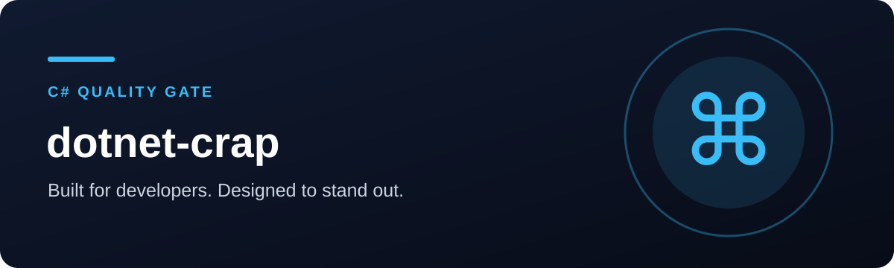

# dotnet-crap

A Rust command-line quality gate for **C# CRAP scores**, inspired by
[typescript-crap](https://github.com/RuiCostafrg/typescript-crap).

This first version parses real `.cs` files with Tree-sitter and reports callable
complexity, coverage, and CRAP scores. It is distributed as a native executable
for Linux and macOS, installable as a .NET tool, with Homebrew, a shell
installer, or a GitHub Action. Scanning needs no Rust, Node.js or .NET runtime
except for the .NET tool launcher.

```text
CRAP = complexity² × (1 − coverage)³ + complexity
```

Coverage is a fraction from 0 to 1. Missing coverage scores as zero coverage.
Complexity 4 therefore scores 20 uncovered, 6 half covered, and 4 fully covered.
The default threshold is 10; only scores strictly above it fail.

## Build and run

Building requires stable Rust and a C compiler for the C# parser. Scanning with
a prebuilt native executable requires neither Rust nor the .NET SDK.

```sh
cargo build --locked --release
./target/release/dotnet-crap --root examples/Fixture --format json
./target/release/dotnet-crap --root . src --threshold 30
./target/release/dotnet-crap --root . --coverage coverage.json --require-coverage
./target/release/dotnet-crap --root . --format json --output report.json
./target/release/dotnet-crap --root . --format sarif --output report.sarif
```

Source paths are relative to `--root`; coverage and report paths are relative to
the calling directory. Reports are produced for passing and failing score gates.
Exit codes are **0** for pass, **1** for a score gate failure, and **2** for an
argument, source, coverage, or I/O error. `--fail-on-empty` rejects an empty scan.
Missing required coverage and empty-selection gate failures also exit 1.
`--jobs <N>` sets the number of worker threads that scan files (default:
available parallelism, `--jobs 1` scans on one thread); it never changes the
report or which error is reported, and `0` is rejected.
`--define <SYMBOL>` (repeatable; `A,B` and `A;B` lists accepted) sets
conditional compilation symbols. They matter only for a file that does not
parse as written: its `#if` groups are then resolved and the file is parsed
again, keeping line numbers. Files that parse are unaffected. See
[conditional compilation](docs/PREPROCESSOR.md).
`--skip-unparsed` (also on `collect`) skips a selected file whose final failure
is a syntax error instead of failing the scan; skipped files are listed in the
text, JSON and SARIF reports and contribute no callables. Other errors, such as
unreadable or non-UTF-8 sources, still fail. Off by default.
[SARIF output](docs/SARIF.md) includes score, missing-required-coverage, and
empty-selection diagnostics for code-scanning integrations.

## Configuration

Scans honor `.gitignore` and `.ignore` files and an optional versioned
`dotnet-crap.json` with `include`/`exclude` globs; explicit command-line flags
override the file (`--config`, `--no-config`, `--no-ignore`, `--include`,
`--exclude`). See [configuration](docs/CONFIG.md).

## Rust library

The package also exposes `dotnet_crap::{ScanOptions, scan, ReportFormat}` so Rust
code can scan and render reports without starting the CLI. Gate failures are
reported by `ScanResult::report().failed`; input errors are returned as `Err`.
`ScanOptions::jobs` is the library form of `--jobs`, and `ScanOptions::defines`
of `--define`; `ScanOptions::skip_unparsed` is `--skip-unparsed`.
See the [Rust API guide](docs/RUST_API.md) for consumption, verification, and
limits. Run the bundled example with `cargo run --example scan -- <root>`.

## Coverage and scope

The initial [native coverage format](examples/COVERAGE.md) uses root-relative
source paths and SHA-256 hashes of exact source bytes. It rejects stale coverage.
Fresh Coverlet evidence can be collected with `dotnet-crap collect` using an
explicit trusted command; see [collection and runner limits](docs/COVERLET.md).
The initial denominator is the supplied coverage points inside each callable;
producers must include zero-hit points. `--require-coverage` requires some
evidence per callable, rather than proving complete statement coverage.

The scanner supports C# methods, constructors, operators, conversions, destructors,
explicit accessors, expression-bodied properties/indexers, and nested callables.
See [callable support and limits](docs/CSHARP_CALLABLES.md). F#, Visual Basic, semantic
compilation, conditional-compilation symbol resolution, Git/PR selection,
baselines, and additional report formats are future work. See the
[full feature-parity plan](docs/FEATURE_PARITY.md) for the TypeScript feature
mapping, .NET-specific requirements, milestones, and acceptance criteria.

## Installation

> The current release is **v0.2.2** (immutable GitHub release). Its NuGet.org,
> Homebrew, shell-installer and GitHub Action channels were verified after
> publication. Pin an exact version in CI. See
> [distribution design](docs/DISTRIBUTION.md).
> npm distribution is retired and its packages were removed from the registry; use the .NET tool or Homebrew instead.

Prebuilt targets: macOS x86-64/ARM64 and Linux x86-64/ARM64 (glibc builds and
fully static musl builds that also run on Alpine). Windows is only bundled in
the .NET tool for now.

**.NET tool** (primary channel; requires a .NET 10 or .NET 11 runtime), from
[NuGet.org](https://www.nuget.org/packages/dotnet-crap):

```sh
dotnet tool install --global dotnet-crap --version 0.2.2
```

To install the exact bytes built by the release workflow instead, download
`dotnet-crap.0.2.2.nupkg` from the
[v0.2.2 GitHub release](https://github.com/RuiCostafrg/dotnet-crap/releases/tag/v0.2.2),
authenticate its provenance and use it as a local feed:

```sh
gh attestation verify ./download/dotnet-crap.0.2.2.nupkg --repo RuiCostafrg/dotnet-crap
dotnet tool install --global dotnet-crap --version 0.2.2 --add-source ./download
```

See [NuGet publishing](docs/NUGET_PUBLISHING.md) and
[packaging](packaging/README.md) for local package creation.

**Homebrew** (macOS and Linux):

```sh
brew install RuiCostafrg/tap/dotnet-crap
```

**Shell installer** (installs to `~/.local/bin`):

```sh
curl --proto '=https' --tlsv1.2 -LsSf \
  https://github.com/RuiCostafrg/dotnet-crap/releases/download/v0.2.2/dotnet-crap-installer.sh | sh
```

Or download `dotnet-crap-<target>.tar.xz` and its `.sha256` from
[GitHub Releases](https://github.com/RuiCostafrg/dotnet-crap/releases) and verify
the build provenance with
`gh attestation verify dotnet-crap-<target>.tar.xz --repo RuiCostafrg/dotnet-crap`.

**GitHub Action** (installs a pinned release after verifying its build
provenance and SHA-256, then optionally scans and uploads SARIF):

```yaml
- uses: RuiCostafrg/dotnet-crap@<full commit SHA> # v0.2.2
  with:
    version: 0.2.2
    scan: true
    sarif: true
    upload-sarif: true # needs `security-events: write`
    args: |
      --root
      .
      --coverage
      coverage.json
      --require-coverage
```

Collect `coverage.json` beforehand with `dotnet-crap collect` (see
[Coverlet collection](docs/COVERLET.md)); the action puts `dotnet-crap` on `PATH`.
Ubuntu and macOS runners are supported.

## Development

See [CONTRIBUTING.md](CONTRIBUTING.md) for checks, including the live .NET fixture
suite, and [SECURITY.md](SECURITY.md) for coverage trust and release verification.
Licensed under [MIT](LICENSE).

Fresh pinned Coverlet collection is available through `dotnet-crap collect`; see
[the command, mapping contract and runner limits](docs/COVERLET.md).
